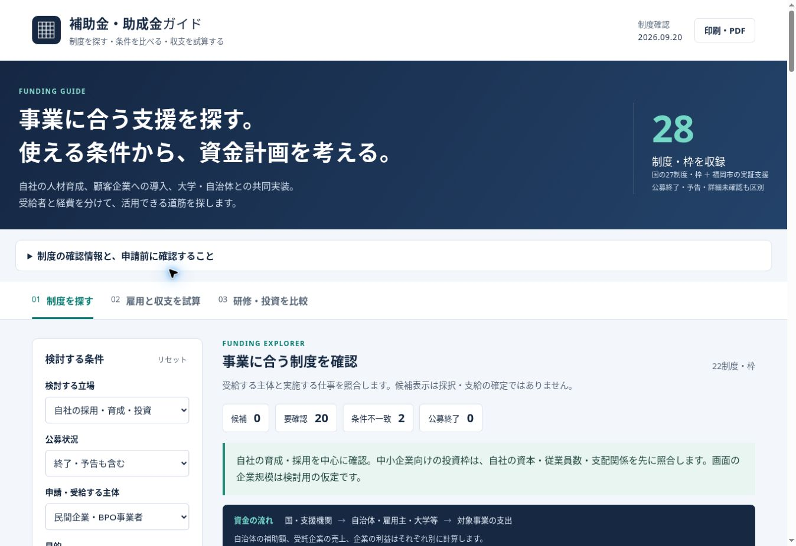

# 補助金・助成金ガイド

AI実装・人材育成・研究開発に関する制度探索と条件付き試算のWebアプリです。

**情報確認基準：2026年9月20日。** 国の27制度・枠と福岡市の実証支援1件、計28件を収録しています。この件数には、公募終了・予告段階・詳細未確認のものや、委託研究・返済型資金・現物支援も含まれ、画面上で区別して表示します。



## 解決する問題

補助上限だけを並べると、受給者が異なる資金や対象外の費用まで足し合わせてしまいがちです。また、企業規模や資本関係の判定基準は制度ごとに異なるため、推定だけでは受給資格を確定できません。そこでアプリでは、受給者を次のように分けて扱います。

- 自社：従業員の採用・育成、自社への投資。
- 顧客企業：顧客が申請・受給し、提供事業者はAI導入や研修の提供を検討。
- 大学・自治体等：交付先と、共同研究・受託先を区別。

## 使える機能

1. 立場、申請主体、目的、企業規模、支配関係、公募状況などで制度を絞り込む。
2. 人数・勤務時間・賃金・入金年を変え、雇用助成と3年間の簡易資金収支を比較する。
3. 6区分の設備・システム投資と、事業展開等リスキリング支援の研修を試算する。
4. 制度ごとの条件・併用制限・確認日・公式出典を読む。表示した画面を印刷・PDF保存する。

要件が確認できていない金額は試算に算入しません。試算結果は、研修方式・人数・投資額・上限によって変わります。研修については、事業所・年度ごとの上限1億円の残額も反映します。

## 実行

画面だけを試す場合は、このフォルダーでPython 3の静的サーバーを起動します。

```sh
python3 -m http.server 4175 --bind 127.0.0.1 --directory dist
```

同じPCのブラウザーで`http://127.0.0.1:4175/`を開きます。Windowsでは必要に応じて`python3`を`py -3`に読み替えてください。

開発・回帰テストにはNode.js 22.12以上を使用します。このフォルダーで次を実行してください。

```sh
npm ci
npm run dev -- --host 127.0.0.1
npm test
```

画面本体は、`dist/` にあるHTML／CSS／JavaScriptの静的ファイルで、任意の静的HTTPサーバーで動作します。Viteは開発用で、計算処理の実行には不要です。LLM API・バックエンド・データベースは使いません。フォーム入力はブラウザー内で処理し、自動保存しません。

## 構成

| ファイル | 役割 |
| --- | --- |
| `dist/programs.js` | 28件の制度データ・出典・確認状態・活用案 |
| `dist/app.js` | 絞り込み、資格に関する注意表示、雇用収支、画面制御 |
| `dist/estimates.js` | 投資・研修の計算関数（副作用なし） |
| `dist/index.html` / `dist/styles.css` | 画面・表示・レスポンシブ対応 |
| `tests/funding.test.cjs` | 条件未確認、上限、対象外、二重計上防止などの回帰テスト |
| `docs/` | 調査出典、開発上の判断、画面操作の検証記録 |

## 開発・検証の記録

[開発と判断](docs/DEVELOPMENT.md)、[調査出典](docs/SOURCES.md)、[検証結果](docs/VERIFICATION.md)を参照してください。実装に加えて、一次資料との照合、誤った加算を防ぐ設計、画面操作で見つけて修正した点を記録しています。

## 更新の手順

公募日程・助成率・上限・対象者・併用条件を公式の最新要領で確認し、`programs.js` と計算式を同時に更新してください。確認日だけを更新することは避けてください。更新後は `npm test` と代表的な画面操作を再実施します。

## 前提と限界

- 収録制度は全国の全制度を網羅したものではありません。Go-Techは、2026年9月20日の確認時点で現行要領を確認できなかったため、収録を保留しています。
- 試算結果は入力した仮定に基づくもので、採択・支給や個別企業の受給資格を確定するものではありません。
- 税・会計上の利益、資金調達、費目別の全条件、特例のすべてを再現した申請エンジンではありません。新設法人の資料、株主構成、親会社の制度上の規模、従業員数、雇用保険・事業者登録は、申請者ごとに確認が必要です。
- 第三者資料の著作権は各権利者に帰属します。
